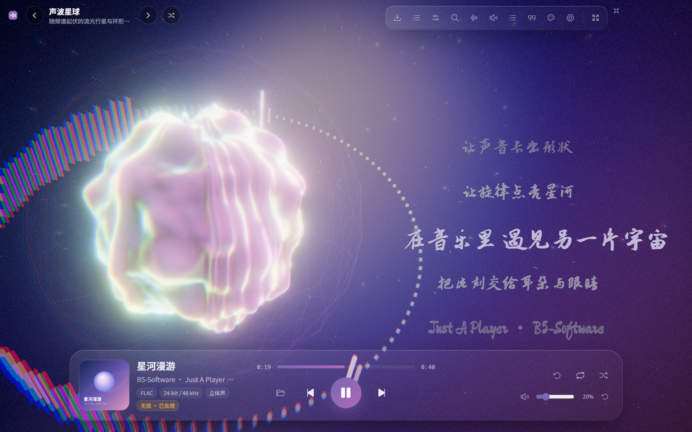
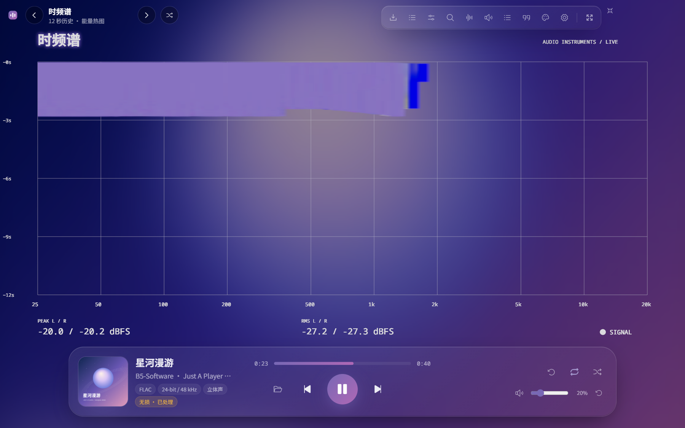
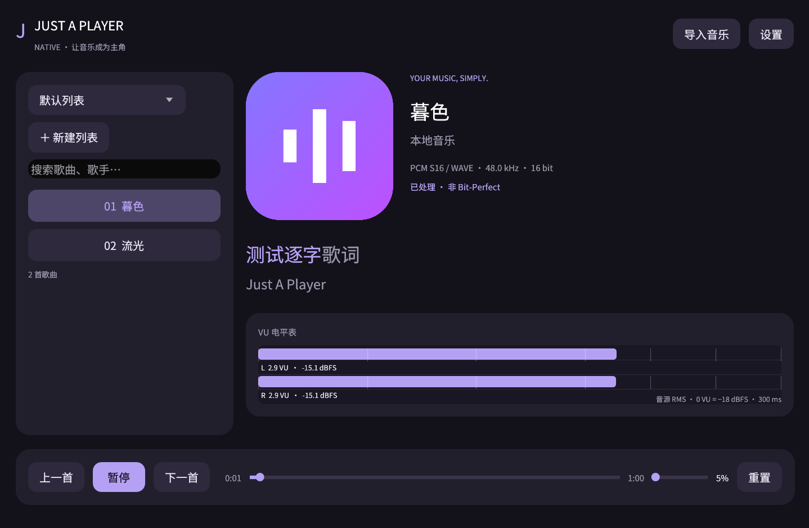
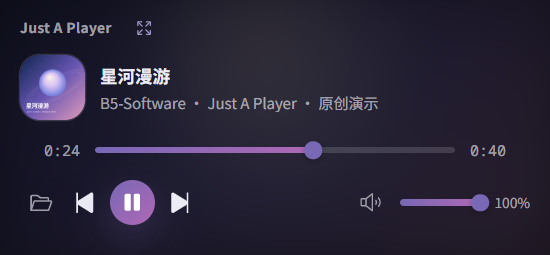
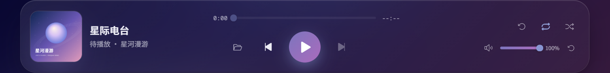

<div align="center">


# Just A Player

[简体中文](README.md) · **English**

### HiFi that looks good.

Give sound a shape. A music player by **[B5-Software](https://b5-software.org)**.

[](https://github.com/B5-Software/just-a-player/actions/workflows/build.yml)
[](https://github.com/B5-Software/just-a-player/releases/latest)

**[Download](https://github.com/B5-Software/just-a-player/releases/latest)** · **[Visuals](#see-the-music)** · **[Audio](#play-it-properly)** · **[Build](#build-from-source)**

</div>



## See the music

Artwork colors flow into the background, controls and lighting. Scenes respond to the music, while lyrics have their own space, fonts and orientation.

- **Material stages:** Silk, Tide, Wind Traces and Refraction use soft light, fabric, water, glass and open space. Their shared rendering definitions support HDR, linear-space edge antialiasing, fullscreen interaction and independent layouts.
- **Pluggable effects:** enable each effect individually or import JSON / GLSL plugins. Additional scenes and instruments are off by default and loaded on demand. See the [plugin guide](docs/visual-plugins.md).
- **Spatial lyrics:** 2D / 3D word-synchronized scrolling, embedded `LYRICS`, and LDDC bracketed word timestamps. Adjust size, position and rotation independently. The setup guide provides test lyrics and saves your layout automatically.
- **A considered interface:** blurred artwork, glass panels, automatic accents, gradual track-color transitions, light/dark themes and a custom rounded tray panel.
- **Your fonts:** ten bundled OFL fonts, including brush, handwriting and playful styles. Import TTF, OTF, WOFF, WOFF2, TTC or OTC.
- **Professional meters:** oscilloscope, spectrum, spectrogram, stereo phase and stereo VU meters. Each is optional and off by default. VU needles use 300 ms smoothing and peak hold; labels use OFL fonts.
- **Rendering fallback:** if graphics initialization fails, artwork, 2D lyrics and playback controls remain available. Retry 3D when ready; wallpaper also has an independent fallback.
- **Languages:** English and Simplified Chinese across the full interface, native mode and tray. The default follows the system, with English for unsupported languages. Change it in Settings; track metadata, filenames and lyrics remain in their original language.



### Or keep it quiet

**Lightweight mode** uses a native Rust / egui interface on Windows, macOS, Linux, Android and the HarmonyOS preview. Its UI does not use a WebView. It retains artwork, word-synchronized lyrics, collapsible playlists, HiFi output, EQ and five individually selectable meters.

The desktop interfaces share one background audio session. Switching does not pause playback, reopen the DAC or reconnect NetEase. A headless Node host loads the Rust engine without a Chromium window; its memory cost is additional to the native UI. Launching the Rust executable independently still uses an in-process Rust engine.

No 3D scenes are loaded. With all meters off, visualization analysis is disabled. Desktop background playback and a native tray panel remain available; hiding the window releases presentation resources. See [native mode and building](docs/lightweight.md).



### Music on your desktop

Mini player collapses the main window into a compact artwork-and-controls view. Windows wallpaper mode fills the desktop with lyrics and visuals, including multiple monitors, pointer tracking, date and time.

When the main window appears, wallpaper transitions to a blurred still frame and suspends drawing. Animation returns in mini player or background mode. Hidden or minimized surfaces stop rendering.

<p align="center"></p>

## Play it properly

An independent **Rust audio engine** decodes and outputs audio. The interface controls playback and visuals. The signal-path panel shows source format, processing and actual output format.

| Platform | Native output paths | Packages |
| --- | --- | --- |
| Windows | WASAPI shared / exclusive, ASIO | x64, ARM64 |
| macOS | CoreAudio, CoreAudio Hog exclusive | Intel x64, Apple Silicon ARM64 |
| Linux | ALSA shared, `hw:` exclusive | x64, ARM64 |
| Android | AAudio, USB Host exclusive / DoP / device-supported native DSD | Universal APK: ARM64, 32-bit ARM, x86, x86_64 |

- **Source format first:** negotiates actual device rates, bit depths and channels, shown in a capability table. Unsupported formats use 64-bit FFT antialias resampling and bit-depth adaptation, explicitly marked **not bit-perfect**. Supported source formats bypass resampling.
- **DSD:** DSF / DFF, DSD-to-PCM, DoP and ASIO native DSD on supporting drivers. The signal card identifies DSD. DoP needs both a compatible DAC and exclusive output; native DSD requires a suitable driver. Windows ARM64 ASIO also needs an ARM64 driver.
- **DSP & EQ:** equalizer, sound presets and app volume. The default volume is **20%**. For bit-perfect playback, disable DSP, set app volume to 100% and verify the hardware output format.
- **MIDI:** one Rust synthesizer across platforms, supporting MID / MIDI / KAR / RIFF MIDI, tempo changes, multiple tracks, pedals, pitch bend and drums. The with-midi package includes **MuseScore General HQ 0.2.1 lossless SF2**, defaulting to 96 kHz Float32, 512 voices and 7th-order interpolation. Import an SF2 or choose 44.1 / 48 / 96 kHz.
- **Buffer recovery:** detects stream interruptions and rebuilds buffering. Manual reset is available in the playback dock, beside repeat controls, in the tray and in output settings.
- **Large and unusual sources:** PCM / RF64 / BW64, FLAC, DSD, NCM and disc tracks are read in blocks, with seekable sources and bounded playback buffers. Float64 is preserved when supported by the driver; adaptation is reported otherwise. Spectrum analysis uses a separate copy without modifying DAC samples.
- **System controls:** media keys and background playback. Windows media controls show metadata, artwork and playback / track controls, including in native mode.

macOS and Linux backends are compiled and smoke-tested on native CI runners with null output. Specific DACs, exclusive formats and DSD rates require corresponding hardware validation. Software cannot replace a vendor driver or claim unreported DSD256 support.

### Take over a local NetEase client

On Windows, open **External player · NetEase Cloud Music** in either interface to connect a running 64-bit client. Select **Just A Player HiFi Bridge (Black Hole)** as its output, or switch from the connection panel. The bundled Rust module exposes this device only inside the connected client; it installs no system driver and does not open your DAC. The client's final mix is discarded to avoid competing outputs.

- FLAC prefers original compressed packets before effects, decoded in Rust. Other supported codecs forward native decoded PCM before client effects. Bounded queues do not create a temporary full-track audio file.
- Metadata, artwork, lyrics, timeline and the real client queue sync to both interfaces. Click a client track to play it. Repeat all, repeat one and shuffle control NetEase directly. Only the client advances its live queue, avoiding duplicate automatic next-track actions.
- Pause, resume, seek and media controls are forwarded. Word-synchronized lyrics work when supplied by the client.
- **Force takeover** skips the verified-version whitelist to try changed module IDs and additional PCM formats. Packet lengths, timestamps and memory boundaries remain checked; unverified formats are not labeled bit-perfect.
- Disconnecting, quitting or choosing local audio releases Rust output before restoring and reading back the previous client device. Pausing suspends decoder capture; resuming resynchronizes it. Transient control failures are retried, and interrupted renderer connections have bounded recovery attempts.

Switching desktop interfaces retains the host and connection. An independently launched Rust player starts the headless client adapter only when needed.

The verified client is **NetEase Cloud Music 3.1.41 x64 / CEF 91 / FFmpeg 58**. New versions and other clients require individual adaptation. Software-level lossless FLAC sample consistency has been compared; DAC bit-perfect playback still depends on exclusive output, format negotiation, disabled DSP and 100% app volume. Forwarding AAC / MP3 cannot restore information lost during compression. Live takeover does not provide full-file source analysis or offline video export.

Developer validation: `node apps/desktop/scripts/e2e-external-player.mjs --live-client`, after building the engine, virtual output module and interface. It operates the current client track, uses null Rust output and checks routing, artwork, transport, seeking, reset and device restoration. Use a test track.

### A library you can organize

Supports common formats such as FLAC, WAV, AIFF, ALAC, MP3, AAC and Ogg, plus APE, DTS, DSD, SACD ISO and CD ISO / CUE. SACD reads the disc's native track directory and metadata, preferring stereo; each track has independent timing, seeking and export without extraction. CD images use companion CUE tracks and CD-Text, including multi-file CUE raw CD-DA sectors. Raw disc audio without a track table cannot reliably recover original track boundaries. Bundled FFmpeg handles extended formats including APE / DTS; native Rust FLAC decoding handles 24-bit / 768 kHz in blocks with exact seeking.

**Import and play NCM directly:** a seekable Rust decryption source based on [ncmdump-js-b5s](https://github.com/B5-Software/ncmdump-js-b5s) reads only what the decoder needs, without creating a converted audio file.

- Multiple playlists, search, drag ordering, shuffle / repeat and M3U / M3U8 / JSON import/export.
- Automatic scans of Music, common NetEase download folders and custom folders.
- Better-quality duplicate formats take priority; matching LRC files bind consistently.
- Per-playlist track, position and shuffle-order memory. Restart does not autoplay; Play resumes.
- Before playback, the dock shows the **playlist name** and **upcoming artwork**.
- OS “Open with” adds audio to a separate external-open playlist and starts it without replacing existing lists. Desktop packages register file types; Android accepts granted audio URIs. MIDI and a same-name recording are retained as different content.
- **Online radio:** save direct HTTP / HTTPS audio or M3U / PLS stream URLs to a playlist. Disconnections reconnect automatically; resume returns to live playback. Local tracks and streams can share M3U lists. Segmented HLS streams are not currently supported.



### Inspect the source. Export the stage.

**Source quality analysis** provides a numerical technical-integrity score using clipping, noise, dynamics, spectral bandwidth and effective-bit observations. It runs independently of playback. Sampling is not a guarantee that a whole track is clean, an authenticity certificate or proof of AI upsampling; noise may belong to the recording.

**Video export** saves selected or current tracks with the same scene and lyrics definitions used by playback. Jobs run sequentially in an independent background queue, leaving the player usable. Each job captures its visual, font, lyric and custom-signature settings. Opening and closing metadata cards fade in and out and adapt to video aspect ratio.

Choose video size, frame rate, quality, hardware encoder and audio format / bitrate, including lossless FLAC, PCM and original-audio remux when the container supports it. MIDI must be synthesized; float audio cannot be stored losslessly as FLAC. Original remux cuts follow encoded frame boundaries. Export currently uses SDR. Android uses bundled FFmpeg / x264 in the background.

HDR is off by default. Supported displays and rendering paths can enable it, with independent frame limits, render resolution and post-processing controls. Windows also offers GPU selection. Local OpenRGB SDK integration can sync hardware lights with the accent color.

Android's native GPU HDR surface receives shaders, audio parameters and changed textures without per-frame pixel readback. Resolution and frame rate follow quality settings, including extra scenes and meters. Emulator rendering checks do not validate a physical phone's HDR brightness or performance.

Android uses its actual landscape viewport rather than system DPI to fit controls. UI size is adjustable without reducing render resolution. Touch supports stage / lyrics dragging and playlist reordering; tapping reveals hidden controls. Sliders require a deliberate horizontal drag, so taps and vertical swipes do not change their values. Full mode uses an app-styled file browser with a horizontal locations rail and fixed footer; the desktop mini player's import uses the native OS chooser.

## Download

Get installers from **[the latest release](https://github.com/B5-Software/just-a-player/releases/latest)**. Choose your OS and architecture. Every package has two variants:

| Variant | Contents |
| --- | --- |
| `with-midi` | Includes the HQ SF2 soundfont; MIDI works immediately |
| `without-midi` | Omits the roughly 467 MiB soundfont; retains the synthesizer and manual SF2 import |

Both include native lightweight mode, codecs and the other audio features. Android is a **universal signed Release APK**, covering ARM64, ARM32, x86 and x86_64. Modern Android toolchains no longer support MIPS. Install the APK manually and authorize file / USB access when needed.

Desktop installers bundle FFmpeg and FFprobe; Android bundles its native codecs. Installed playback and video export do not require a separate FFmpeg installation. Packages include licenses; corresponding FFmpeg source archives and checksums accompany releases. See [third-party notices](THIRD_PARTY.md).

HarmonyOS PC remains a native ARM64 / x86_64 preview with its existing SDK and device-validation limitations, not a verified general-release package. See the HarmonyOS project documentation.

## Build from source

Requires Rust stable, Node.js, pnpm and platform native build tools. Linux needs ALSA and desktop development libraries. Android additionally needs JDK 17, the Android SDK / NDK and Gradle dependencies. Use the repository's build scripts and lockfiles.

```sh
git clone https://github.com/B5-Software/just-a-player.git
cd just-a-player
corepack enable
pnpm install --frozen-lockfile
pnpm build
pnpm dev
```

The development entry checks Electron's executable to avoid missing-binary `Electron uninstall` errors. Initial builds download and verify the platform's FFmpeg tools, cached in `apps/desktop/build/media-cache/`; installed apps do not download these components. URLs and SHA-256 values are pinned in `apps/desktop/scripts/media-tools.lock.json`. Extraction uses system `tar`, included with Windows 10/11. Rebuild the Rust engine after Rust changes with `pnpm engine:build`.

The default with-midi build downloads about 262 MiB and unpacks about 467 MiB of HQ SF2 data at build time. Set `JAP_BUNDLE_MIDI=0` for without-midi; cached soundfonts are also excluded from that package. Origins, checksums and licenses are in `assets/soundfonts/documentation/`.

```sh
pnpm typecheck
cargo fmt --all -- --check
cargo clippy --workspace --all-targets -- -D warnings
cargo test --workspace --locked
pnpm --filter desktop test:e2e:smoke
pnpm --filter desktop test:e2e:media
pnpm --filter android build       # universal signed Release APK
pnpm package                     # installers in apps/desktop/release/
```

CI compiles, checks, tests and packages on Windows, macOS and Linux x64 / ARM64 runners, then launches packaged apps for validation. Six desktop targets with two soundfont variants plus two Android universal Release variants produce **14 jobs and 22 installer files**. Android additionally checks signing, non-debug flags, 16 KiB alignment and emulator playback. Pushing a `v*` tag publishes a release only after all builds and FFmpeg source-download verification succeed.

Intel macOS hosted VMs may lack a usable graphics device. CI records that limitation and checks artwork / 2D-lyrics fallback with capability reports and screenshots; other desktop targets require normal 3D startup. Real Intel Mac GPU behavior still needs hardware validation. Audio and controls remain usable without WebGL 2.

### Repository layout

```text
apps/desktop/        Electron, React interface, Three.js visuals, packaging
apps/lightweight/    Native desktop shell and tray
apps/android/        Android host, USB and native HDR integration
apps/harmony/        HarmonyOS preview
crates/jap-core/     Audio types and process protocol
crates/jap-decode/   Native decoding, NCM, DSD, disc containers and streams
crates/jap-output/   WASAPI, ASIO, CoreAudio, ALSA and null output
crates/jap-engine/   Playback state, buffering, DSP and shared host client
crates/jap-analysis/ Source and signal analysis
crates/jap-light/    Shared native UI
crates/jap-napi/     Node-API bridge
```

## Open source & credits

Copyright © 2026 **B5-Software**. Licensed under **[GNU GPL v3.0 or later](LICENSE)**.

Bundled fonts use SIL Open Font License 1.1; no commercial fonts are embedded. Third-party components retain their respective licenses. See [THIRD_PARTY.md](THIRD_PARTY.md); packages include dependency notices. Thanks to the Rust, Symphonia, CPAL, ALSA, Electron, React, Three.js, NCM, DST-decoder and open-font communities.

Screenshots show the actual application. Demo audio, artwork and lyrics are generated for the project and do not include a user's library or commercial song assets.
