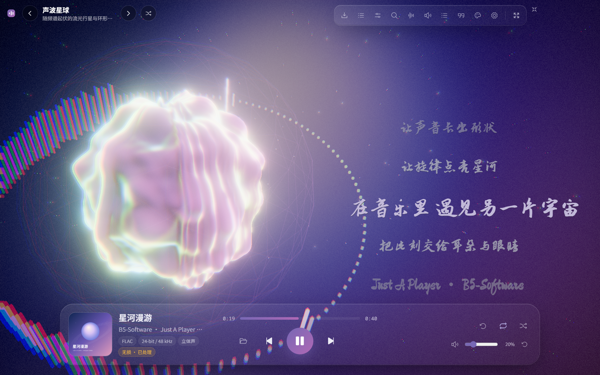
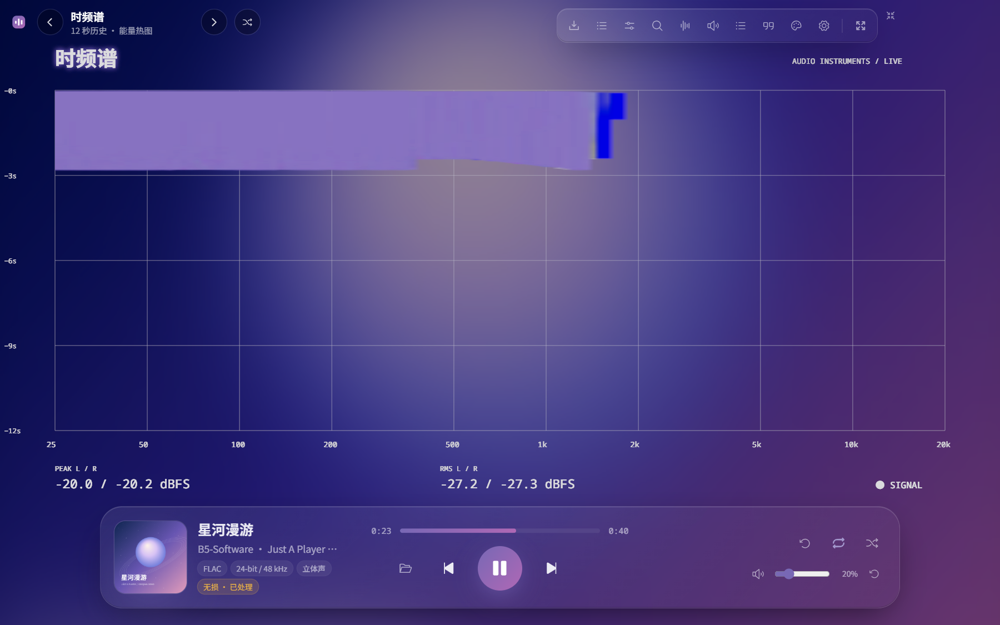
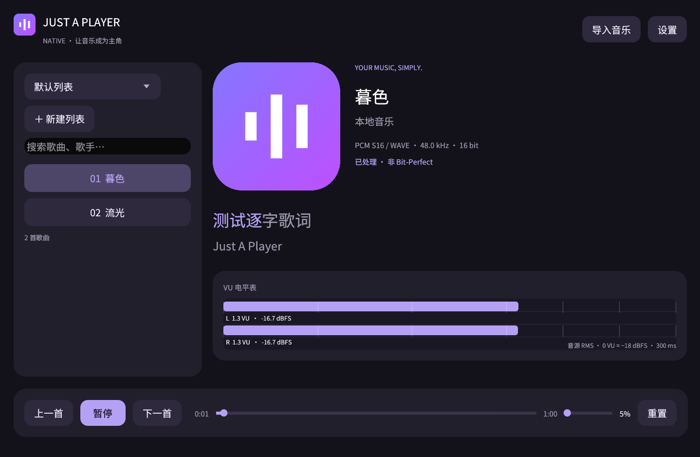
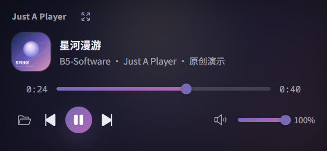
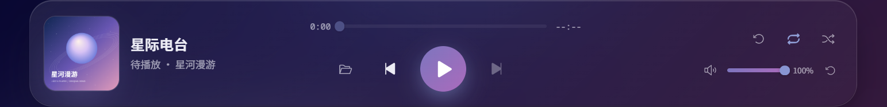

<div align="center">


# Just A Player

### HiFi，也好看。

让声音长出形状。一个由 **[B5-Software](https://b5-software.org)** 打造的本地音乐播放器。

[](https://github.com/B5-Software/just-a-player/actions/workflows/build.yml)
[](https://github.com/B5-Software/just-a-player/releases/latest)
[](https://github.com/B5-Software/just-a-player/releases)
[](LICENSE)

**[下载安装包](https://github.com/B5-Software/just-a-player/releases/latest)** · **[界面与功能](#看见音乐)** · **[音频输出](#认真播放)** · **[从源码构建](#从源码构建)**

</div>



## 看见音乐

封面的颜色缓缓流入背景、控件与光影。3D 场景随音乐起伏，歌词也有自己的空间、字体和姿态。

- **材质舞台**：默认提供丝境、潮汐、风痕、折光四种效果，以柔光、缎面、水面、玻璃和留白呈现音乐，使用共享的 HDR 线性空间边缘抗锯齿。支持全屏、鼠标交互与独立布局。
- **可插拔效果**：每个效果独立开关，可导入 JSON / GLSL 插件。附加场景和仪表默认隐藏，各自有独立开关，按需加载；参见[插件说明](docs/visual-plugins.md)。
- **立体歌词**：2D / 3D 逐字滚动歌词，支持内嵌 `LYRICS` 和 LDDC 方括号逐字时间戳；可调字号、独立位置与旋转。新手指导提供测试歌词，调整后自动保存。
- **细腻的界面**：模糊封面、玻璃卡片、自动强调色、切歌颜色过渡、深浅主题与圆角自绘托盘。
- **字体自由**：内置 10 种 OFL 歌词字体，涵盖楷体、毛笔、手写与可爱风格；支持导入 TTF、OTF、WOFF、WOFF2、TTC、OTC。
- **专业仪表**：示波器、频谱、时频谱、相位仪和双声道 VU 表，逐项开关、默认关闭。VU 表提供 300 ms 平滑指针与峰值保持；文字和刻度使用 OFL 字体。
- **渲染保护**：图形初始化失败时保留封面、2D 歌词和播放控制，并可重试 3D；壁纸同样有独立的封面与歌词回退。



### 也可以，安静一点

设置中的 **原生轻量模式** 使用 Rust / egui 直接绘制 2D 界面，支持 Windows、macOS、Linux、
Android 与鸿蒙预览。轻量界面不使用 WebView；桌面切换后退出 Electron；
保留封面、逐字歌词、列表、HiFi 输出与 EQ，五种专业仪表各自开关、默认关闭。
不加载 3D 场景；关闭仪表后连同可视化分析一起停用。桌面支持后台播放和原生托盘控制，收起后释放界面绘制资源。
参见[轻量模式、依赖与构建](docs/lightweight.md)。



### 音乐可以留在桌面

选择悬浮播放，主窗口直接收起为小窗，封面与播放控制仍在手边。Windows 桌面壁纸可全屏展示歌词与视效，支持多显示器、鼠标跟随、日期与时间。

主窗口显示时，壁纸渐变为保留画面的静态模糊背景；小窗或后台播放时恢复动态。可视化场景只由当前活动的舞台渲染，隐藏或最小化的窗口暂停绘制。

<p align="center"></p>

## 认真播放

音频由独立进程中的 **Rust 引擎**解码与输出，界面负责控制和可视化。信号链卡片展示源格式、处理过程与实际输出格式。

| 系统 | 原生音频路径 | 安装包架构 |
| --- | --- | --- |
| Windows | WASAPI 共享 / 独占、ASIO | x64、ARM64 |
| macOS | CoreAudio、CoreAudio Hog 独占 | Intel x64、Apple Silicon ARM64 |
| Linux | ALSA 系统共享、`hw:` 硬件独占 | x64、ARM64 |
| Android | AAudio、USB Host 独占 / DoP / 设备支持的原生 DSD | 一个 universal APK：ARM64、32 位 ARM、x86、x86_64 |

- **原始格式优先**：按设备实际支持的采样率、位深和声道协商，输出设置展示能力表。设备不支持源格式时，使用 64 位 FFT 抗混叠降采样及位深适配，信号链明确标明**非 bit-perfect**；支持原始格式时直接绕过采样率转换。
- **DSD**：DSF / DFF、DSD 转 PCM、DoP，以及支持驱动上的 ASIO 原生 DSD；解码卡片显示 DSD 格式。DoP 需要设备与独占路径共同支持，原生 DSD 需要对应 ASIO 驱动。Windows ARM64 的 ASIO 还需要 ARM64 驱动。
- **DSP 与 EQ**：均衡器、预置音效和应用内音量。默认音量 **20%**；追求 bit-perfect 时应关闭 DSP、将应用音量设为 100%，并确认实际硬件输出格式。
- **MIDI 实时演奏**：四个平台使用同一个 Rust 合成器，支持 MID / MIDI / KAR / RIFF MIDI、速度变化、多轨、踏板、弯音和鼓组。随安装包提供 **MuseScore General HQ 0.2.1 无损 SF2**，默认 96 kHz Float32、512 复音与 7 阶插值；可导入自己的 SF2，并选择 44.1 / 48 / 96 kHz。
- **缓冲恢复**：检测流异常后重建缓冲；播放底栏、循环模式旁、托盘及输出设置提供手动重置入口。
- **大文件与高规格**：PCM / RF64 / BW64、FLAC、DSD、NCM 和光盘音轨按块读取，跳转按文件位置定位。播放环形缓冲设有内存上限；Float64 源在驱动支持 Float64 时保留完整精度，不支持时明确显示位深适配。高采样率的频谱分析使用单独副本，不改写送往 DAC 的音频。
- **系统控制**：媒体键与后台播放；Windows 系统控制中心显示曲目信息、封面及播放 / 暂停 / 切歌操作。

macOS 与 Linux 的后端由原生 CI 编译和空设备冒烟测试覆盖；具体 DAC、独占格式及 DSD 档位仍需对应硬件验证。软件无法替代设备厂商的驱动，也不会把驱动未提供的 DSD256 能力标记为可用。

### 本地曲库，好好整理

FLAC、WAV、AIFF、ALAC、MP3、AAC、Ogg 等常见格式，另支持 APE、DTS、DSD、SACD ISO、CD ISO / CUE。SACD ISO 读取曲目目录与曲目信息，按独立歌曲导入，优先立体声区域；每首分别计时、跳转和导出，无需解包。CD 镜像按配套 CUE 的音轨与 CD-Text 拆分，也支持多文件 CUE 的原始 CD-DA 扇区。只有裸音频数据而没有轨道表的 CD 镜像无法可靠恢复原始分轨。APE / DTS 等扩展格式使用内置 FFmpeg；24-bit / 768 kHz FLAC 由原生 Rust 解码器按块读取，保留原始样本与采样率，支持精确跳转。

**NCM 直接导入、直接播放**：Rust 内置可寻址解密数据源，基于 [ncmdump-js-b5s](https://github.com/B5-Software/ncmdump-js-b5s) 实现，读取解码器所需的数据，不生成转换后的音频文件。

- 多列表管理、搜索、拖动排序、随机 / 循环、M3U / M3U8 / JSON 导入导出。
- 自动扫描系统音乐目录、常见网易云下载目录和自定义目录。
- 同名不同格式按质量优先导入，同名 LRC 稳定匹配。
- 每个列表分别记住曲目、进度与随机顺序；重启不自动播放，点击播放后续播。
- 尚未播放时，底栏显示**列表名称**及**即将播放曲目的封面**。
- 在系统“打开方式”中选择播放器，曲目会追加到“外部打开”列表并开始播放，保留已有列表。Windows / macOS / Linux 安装包声明音乐文件关联，Android 接收文件管理器授权的音频 URI。MIDI 和同名录音属于不同内容，均予以保留。



### 分析音源，也导出画面

**音源质量分析**给出数值评分，结合削波、噪声、动态、频谱带宽和有效位使用情况评估，不只读取元数据。升频、扩位与 AI 处理迹象属于带置信度的推测，不能据此证明音频的制作来源。

**视频导出队列**使用独立后台渲染，支持同时排入多首任务，前台仍可听歌。可设置分辨率、帧率、画质、歌词与 3D 动效，片头片尾元数据渐入渐出，并支持自定义署名。音频提供 AAC、Opus、FLAC、PCM 及原始压缩音轨复制等选项，实际可用项取决于输出容器。

导出按音频时间离线生成帧，共用实时舞台的着色器、场景、歌词及字体定义，不需要前台把音乐播放一遍。支持时通过 WebCodecs 将 GPU 画面交给系统视频编码器；其他环境使用内置 FFmpeg。默认导出预算会给前台留出资源，亦可选择优先导出。Android 的导出界面运行在独立进程，帧数据通过管道送往编码器；取消任务会释放后台实例，队列继续。

HDR 默认关闭，支持的设备与图形路径可开启；提供帧率上限、渲染精度、后处理开关，以及 Windows 手动 GPU 选择。设备灯光可通过本机 OpenRGB SDK 服务跟随播放器强调色。

Android 的所有内置效果直接在原生 GPU HDR 表面绘制，仅传递着色器、音频参数、变更的封面、频谱历史与静态刻度，无逐帧像素回读；分辨率和帧率跟随画质设置，附加场景与仪表也可使用 HDR。模拟器覆盖原生与 WebGL 绘制一致性，实际手机的 HDR 亮度和性能仍需真机验证。

Android 根据实际窗口像素计算独立界面比例，避免系统 DPI 挤压布局；设置中可单独调整界面大小，绘制分辨率继续匹配屏幕。触屏支持拖动舞台、歌词及列表排序；轻点舞台即可唤醒隐藏控件。所有滑动条轻点不改值，明确横向拖动才调整；竖向 EQ 先短按再拖动，直接滑动仍用于滚动卡片。设置中可开启“播放时保持屏幕常亮”，暂停或进入后台后释放。

MIDI 是演奏指令，实际音色取决于音色库与合成器，并不携带录音的原始位深或采样率。MIDI 可加入视频导出队列，使用 FLAC / PCM 等保存合成音频；内置音色库的许可说明会一并写入视频旁的 `.midi-license.txt`。

## 下载与运行

前往 **[Releases](https://github.com/B5-Software/just-a-player/releases/latest)** 选择对应架构：

| 平台 | 文件 |
| --- | --- |
| Windows | `Just-A-Player-版本-win-x64-版本类型.exe` / `win-arm64-版本类型.exe` |
| macOS | `Just-A-Player-版本-mac-x64-版本类型.dmg` / `mac-arm64-版本类型.dmg`，另有 ZIP |
| Linux | `Just-A-Player-版本-linux-x86_64-版本类型.AppImage` / `linux-arm64-版本类型.AppImage`；另有 amd64 / arm64 deb |
| Android 9+ | `Just-A-Player-版本-Android-universal-版本类型.apk`，正式 Release 构建、固定密钥签名、强制横屏 |

**所有平台、架构和安装包格式都提供两种版本**：

| 文件名后缀 | 适合 |
| --- | --- |
| `without-midi` | 推荐日常使用：省去约 467 MiB 的内置音色资源；所有录音格式、HiFi 输出和可视化完整保留。仍可导入 SF2 后播放 MIDI |
| `with-midi` | 即装即播 MIDI：完整内置 MuseScore General HQ，无需另外寻找音色库 |

Android 0.1.4：[无内置音色库 APK](https://github.com/B5-Software/just-a-player/releases/download/v0.1.4/Just-A-Player-0.1.4-Android-universal-without-midi.apk) · [含 HQ 音色库 APK](https://github.com/B5-Software/just-a-player/releases/download/v0.1.4/Just-A-Player-0.1.4-Android-universal-with-midi.apk)。两者包名和签名相同，可相互覆盖升级；此前的 `.debug` 调试包独立安装。

发布页附有 `SHA256SUMS.txt`。社区构建暂未使用商业代码签名证书或 Apple 公证。桌面壁纸与 Windows 系统媒体集成为 Windows 功能；其他平台可使用全屏、小窗、媒体键和原生音频输出。

**从 v0.1.1 起，六个平台安装包均内置 FFmpeg / ffprobe 9.0.2 及所需运行库。安装后即可播放 APE / DTS、使用视频导出及全部音轨选项，无需另装解码工具、配置 PATH 或联网下载组件。** 播放、后台编码和音轨封装使用安装目录内的固定版本。

FFmpeg 来自 [TAS-FFMPEG v9.0.2](https://github.com/NevermindNilas/TAS-FFMPEG/releases/tag/v9.0.2)，构建包含 x264、Opus 等编码器，并禁用 nonfree 组件。安装目录附带许可证、构建配置与来源说明；本项目每个新版发布页同时提供 `tas-ffmpeg-9.0.2-corresponding-source.tar.xz`，含完整对应源码、依赖和构建脚本。普通用户只需下载安装包，无需下载源码压缩包。

Windows ARM64 播放器、Rust 音频引擎与输出后端为原生 ARM64；随附 FFmpeg / ffprobe 是 x64 辅助进程，通过 Windows 11 ARM 的兼容层运行。其余五个平台的辅助工具与应用架构一致。GPU 硬件编码、DAC 独占 / DSD 档位仍需要相应设备和驱动；ARGB 联动需要运行 [OpenRGB](https://openrgb.org/) SDK 服务。

默认设置：**3D 歌词、音量 20%、原生渲染精度、不限制帧率、后处理开启；HDR、桌面壁纸与 ARGB 联动关闭**。最小化暂停绘制，后台音频按设置继续播放。

## 从源码构建

**HarmonyOS PC 7.0 实验适配**：真机目标 `aarch64-unknown-linux-ohos`，模拟器目标
`x86_64-unknown-linux-ohos`，同一 HAP 包含两者。已在官方 PC 模拟器验证 OHAudio
播放、高规格 RF64 / FLAC 和内嵌逐字歌词。USB 独占 / DSD 已编译接入，仍需真机 DAC
验证；当前预览不等同于桌面 / Android 的完整发布包。构建及限制见 [鸿蒙说明](docs/harmony.md)。

**Android** 复用同一界面与 Rust 引擎，支持后台媒体控制、画中画和 USB 独占输出。运行 `pnpm android:build` 本地生成正式 universal APK，需要配置自己的签名密钥；具体构建、USB / DSD 条件与模拟器测试见 [Android 说明](docs/android.md)。CI 分别构建并测试两种版本，发布附件仅包含签名 Release APK。

需要 Node.js 24、pnpm 12、Rust stable（至少 1.88），以及本平台 C/C++ 编译环境。Windows 使用 Visual Studio Build Tools 的 C++ 工具链；macOS 使用 Xcode Command Line Tools；Linux 需要 ALSA 开发包：

```sh
# Debian / Ubuntu 构建依赖
sudo apt install build-essential pkg-config libasound2-dev

git clone https://github.com/B5-Software/just-a-player.git
cd just-a-player
corepack enable
pnpm install --frozen-lockfile
pnpm build
pnpm dev
```

开发入口会检查并补齐 Electron 可执行文件，避免 pnpm 依赖变体缺少二进制时出现 `Electron uninstall`。首次 `pnpm build` / `pnpm dev` 也会下载并验证本平台的 FFmpeg 工具包，缓存于 `apps/desktop/build/media-cache/`；后续使用缓存，已安装应用不会下载组件。下载地址和 SHA-256 固定于 `apps/desktop/scripts/media-tools.lock.json`。解压需要系统 `tar`（Windows 10/11 已内置）。若只修改界面，后续直接运行 `pnpm dev`；修改 Rust 后先运行 `pnpm engine:build`。

默认构建 `with-midi`，首次会下载并校验 MIDI HQ 音色库，下载约 262 MiB、解包约 467 MiB，不在运行时下载。设置环境变量 `JAP_BUNDLE_MIDI=0` 可构建 `without-midi`；已缓存的音色库也不会进入该安装包，两种包都可使用轻量模式。来源、SHA-256 和完整许可见 `assets/soundfonts/documentation/`。

```sh
pnpm typecheck
cargo fmt --all -- --check
cargo clippy --workspace --all-targets -- -D warnings
cargo test --workspace --locked
pnpm --filter desktop test:e2e:smoke
pnpm --filter desktop test:e2e:media

# 构建本机安装包，产物位于 apps/desktop/release/
pnpm package
```

CI 在 Windows、macOS、Linux 的 x64 与 ARM64 原生 runner 上编译 Rust、检查类型、执行测试、打包，并启动打包后的程序验证引擎与界面。六个桌面目标各有两种音色版本，加上两种 Android universal Release APK，共 **14 个构建任务、22 个安装包文件**。安装后验证 HQ MIDI 或手动 SF2 导入，Android 另检查签名、非 Debug 标志、16 KiB 对齐及模拟器播放。推送 `v*` 标签后，全部任务成功且对应 FFmpeg 源码下载与校验完成，才发布 Release 与 SHA-256。

Intel macOS 的托管虚拟机无法初始化可用的图形设备时，CI 会明确记录并验证封面 / 2D 歌词回退，保留能力报告与截图；其他五项要求正常 3D 启动。Intel Mac 的实际 GPU 效果仍需实机验证。3D 视效需要可用的 WebGL 2 图形环境，图形不可用时播放器仍能播放和控制音频。

### 项目结构

```text
apps/desktop/       Electron 主进程、React 界面、Three.js 视效与打包配置
crates/jap-core/   音频类型与进程协议
crates/jap-decode/ 原生解码、NCM、DSD 与光盘容器
crates/jap-output/ WASAPI、ASIO、CoreAudio、ALSA 与空输出
crates/jap-engine/ 播放状态机、缓冲与 DSP
crates/jap-analysis/ 音源分析
crates/jap-napi/   Node-API 桥接
```

## 开源与致谢

Copyright © 2026 **B5-Software**。本项目按 **[GNU GPL v3.0 或更新版本](LICENSE)** 发布。

内置字体使用 SIL Open Font License 1.1，未嵌入商业字体。第三方组件保留各自许可证，完整说明见 [THIRD_PARTY.md](THIRD_PARTY.md)；安装包附带依赖许可文件。感谢 Rust / Symphonia / CPAL / ALSA、Electron / React / Three.js，以及 NCM、DST 解码器和开源字体项目。

README 图片来自实际应用界面；演示音频、封面与歌词由项目生成，不含用户曲库或商业歌曲素材。
